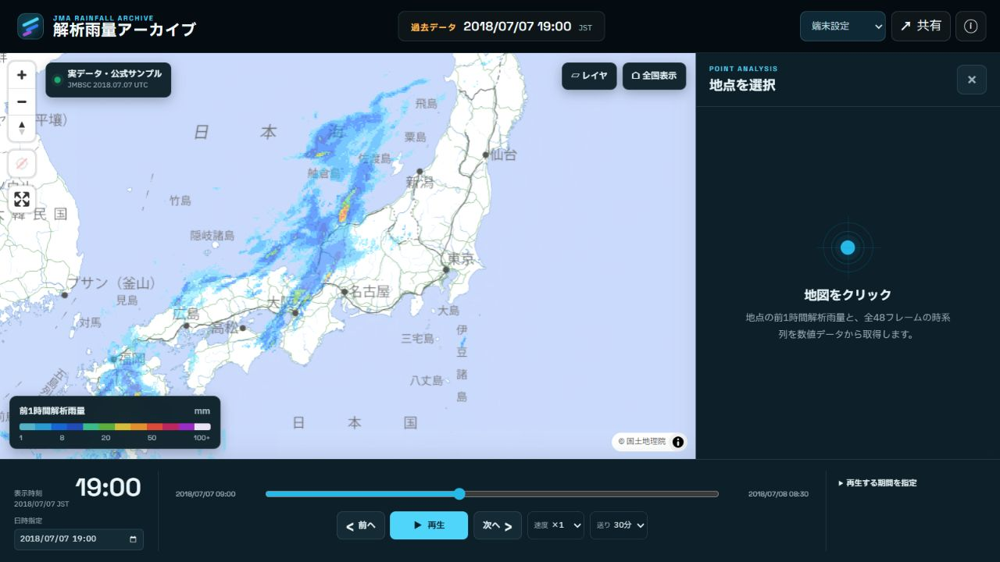
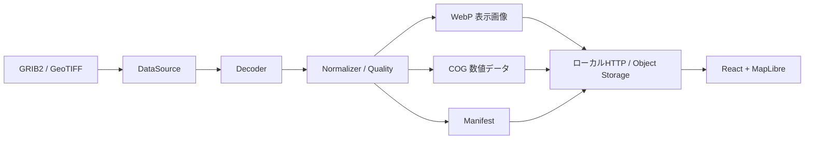

# 解析雨量アーカイブ

2006年以降の気象庁「解析雨量」と、250m高解像度降水ナウキャストのサンプルを、地図上で時間再生・地点分析するWeb GISです。スマートフォンとPCの双方に対応し、バックエンドAPIなしで動作します。

リポジトには、気象業務支援センターが公開する**実際に配信された公式サンプル**を処理した小容量デモが含まれています。解析雨量は48フレーム、250mレーダーは西日本の24フレーム（2018年7月7日、5分間隔）です。人工データではありません。

> 解析雨量の各値は、表示時刻までの「前1時間降水量」です。30分ごとに更新されますが、30分間雨量ではありません。

> 250mレーダーの値は降水強度 [mm/h] です。表示時刻の強さを1時間続けた場合の雨量であり、1時間積算値ではありません。



## すぐに起動する

必要なものはNode.js 20.19以上です。

```powershell
git clone https://github.com/motthyy/Quantitative_Precipitation_Estimation.git
cd Quantitative_Precipitation_Estimation
npm install
npm run dev
```

表示された `http://localhost:5173` をブラウザで開きます。公式サンプル1日分の雨域移動、再生、地点雨量、時系列をすぐ確認できます。

Pythonパイプラインも含めて最初から構築する場合：

```powershell
powershell -ExecutionPolicy Bypass -File scripts/setup.ps1
npm run dev
```

## 実装済み機能

- MapLibre GL JSによる日本地図と解析雨量オーバーレイ
- 解析雨量（1km・30分）と250mレーダー（250m・5分）のレイヤ切替
- 48フレームの30分送り、任意期間再生、×0.5〜×4再生
- 日時直接指定、日跨ぎ、前後移動、時間スキップ
- 表示用WebPと地点数値用COGの分離
- 地図クリックによるnearest-cell地点値取得
- 地点時系列グラフ、CSV・JSON出力
- 正時値だけを使う3〜72時間累積雨量
- 欠測を0 mmにしない処理
- URLによる日時・地図・地点・透明度・レイヤ状態の共有
- レイヤ切替、透明度、全国表示、現在地、Fullscreen
- PCサイドパネルとスマートフォンBottom Sheet
- light・dark・systemテーマ、PWA、キーボード操作
- DEMO鉄道路線・駅・災害地点GeoJSON
- GRIB2検査・独自圧縮デコード・WebP/COG・manifest生成CLI
- 再開、原子的書き込み、checksum、品質検査、エラーJSONL
- Vitest、pytest、Playwright、GitHub Actions、GitHub Pages

## データの意味

解析雨量は、気象レーダーと地上雨量計を組み合わせて解析した1km格子の面的降水量です。[気象庁データ利用ガイド](https://www.data.jma.go.jp/developer/weatherdataguide/appendix/1-1-d.html)および[気象業務支援センターの仕様説明](https://www.jmbsc.or.jp/jp/online/file/f-online30400.html)では、毎正時00分・30分に作成される前1時間降水量とされています。

例えば12:30の値は11:30〜12:30の1時間雨量です。12:00と12:30を両方累積へ加えると30分間が重複します。そのため本アプリの累積雨量は、原則として毎正時の値だけを使用します。正時値が欠けている場合は「欠測を含む」と返します。

詳しくは [docs/rainfall-semantics.md](docs/rainfall-semantics.md) を参照してください。

## 本物のGRIB2をローカルへ保存・表示する

### 1. 公式サンプルを再取得する

```powershell
.\.venv\Scripts\python.exe -m rainfall_pipeline download-sample
.\.venv\Scripts\python.exe -m rainfall_pipeline publish --config config/pipeline.demo.yaml
```

取得元は[気象業務支援センターの実配信サンプル一覧](https://www.jmbsc.or.jp/jp/online/c-onlineGsample.html)です。ダウンロードしたGRIB2は `data/raw/`、処理結果は設定ファイルで指定したローカルフォルダへ保存されます。

250mレーダーの2時間分を再取得・再生成する場合：

```powershell
.\.venv\Scripts\python.exe -m rainfall_pipeline download-radar-sample --hours 2
.\.venv\Scripts\python.exe -m rainfall_pipeline publish --config config/pipeline.radar250m.yaml --force
```

取得元ZIPは約1.36GBで、SHA-256検証後に先頭24個の5分フレームだけを `data/raw/jmbsc-highres-nowcast-20180707/selected/` へ抽出します。表示結果は `public/radar250m/` で、数値格子は250mを維持します。

### 2. 保有する本番GRIB2を処理する

`config/pipeline.demo.yaml` をコピーし、次を自分のフォルダへ変更します。

```yaml
storage:
  type: local
  raw_directory: D:/rainfall/grib
  output_directory: public/local-data
frontend:
  manifest_path: manifest.json
  base_url: /local-data
```

`.env`：

```dotenv
VITE_DATA_PROVIDER=local
VITE_RAINFALL_BASE_URL=/local-data
```

処理：

```powershell
.\.venv\Scripts\python.exe -m rainfall_pipeline publish `
  --config config/pipeline.local.yaml `
  --start 2023-06-01 `
  --end 2023-06-03 `
  --resume
```

`data/raw/`、`public/local-data/`、GRIB2、GeoTIFF、PMTilesは `.gitignore` の対象です。2006年以降の全量をGitやGit LFSへ追加しないでください。

### 全期間データの入手について

気象庁によると、過去のバイナリデータをまとめて入手する場合は気象業務支援センターから入手します。提供条件、費用、媒体、再配布可否を利用者自身で確認してください。本プロジェクトは未知の取得URLを推測した大量スクレイピングを行いません。

## Python CLI

```powershell
# メタデータと雨量範囲
python -m rainfall_pipeline inspect path\to\frame.bin

# 公式サンプル取得
python -m rainfall_pipeline download-sample

# 250mレーダー公式サンプル取得（先頭2時間）
python -m rainfall_pipeline download-radar-sample --hours 2

# 一括処理（decode → WebP/COG → manifest）
python -m rainfall_pipeline publish --config config/pipeline.demo.yaml

# 入力数と容量の事前確認
python -m rainfall_pipeline estimate --config config/pipeline.demo.yaml

# 対象確認のみ
python -m rainfall_pipeline publish --config config/pipeline.demo.yaml --dry-run
```

JMA解析雨量はPDT 4.50008とランレングス圧縮DRT 5.200を使います。一般的なcfgrib/ecCodesだけでは地域テンプレートが不足する場合があるため、本プロジェクトには仕様に基づく専用Decoderを含めています。DecoderはDataSourceや出力処理から独立しています。

## 技術構成

- React 19、TypeScript、Vite
- MapLibre GL JS、Zustand、ECharts、GeoTIFF.js
- WebP image source、数値COG、versioned manifest
- Python 3.11、NumPy、Pillow、Rasterio、Pydantic、Typer
- Vitest、Testing Library、Playwright、pytest、Ruff



詳細は [docs/architecture.md](docs/architecture.md) と [docs/data-format.md](docs/data-format.md) にあります。

## テスト

```powershell
npm run lint
npm run typecheck
npm run test
npm run build
npm run test:e2e

.\.venv\Scripts\python.exe -m pytest
.\.venv\Scripts\python.exe -m ruff check .
```

## GitHub Pages

`.github/workflows/deploy-pages.yml` を手動実行または `main` へpushすると静的アプリを公開します。リポジトリに含める雨量は公式サンプル1日分だけです。全期間データを公開する場合、GitHub Pagesへ置かず別のHTTPオブジェクトストレージを使用し、Repository Variablesの `VITE_RAINFALL_BASE_URL` をその公開URLへ設定してください。

詳しくは [docs/deployment.md](docs/deployment.md) を参照してください。

## キーボード

| キー | 操作 |
|---|---|
| Space | 再生・一時停止 |
| ← / → | 30分移動 |
| Shift + ← / → | 1時間移動 |
| Esc | 地点・パネルを閉じる |

入力欄の編集中は反応しません。

## ライセンスと免責

ソースコードは [MIT License](LICENSE) です。気象データ、背景地図、鉄道等の外部データにはそれぞれ別の利用条件があります。ソースコードのMITライセンスは気象データの再配布を許可するものではありません。

本アプリは研究・防災分析用の過去データビューアです。リアルタイムの生命・安全判断を本アプリだけに依存しないでください。
