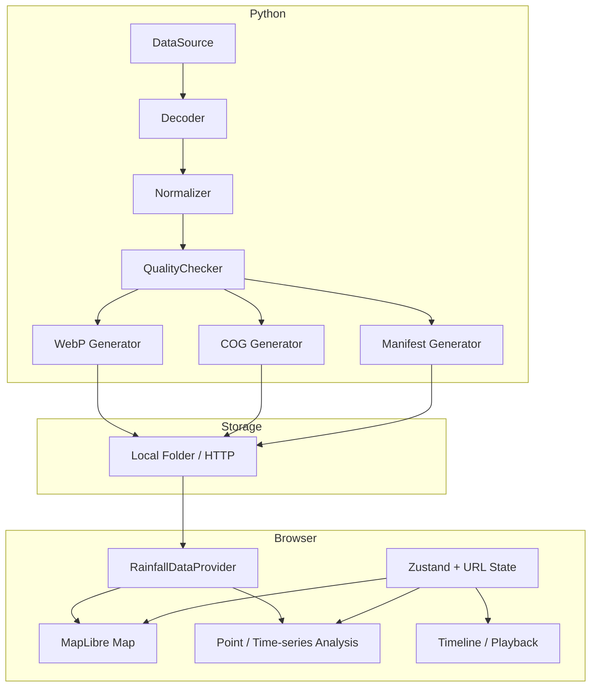
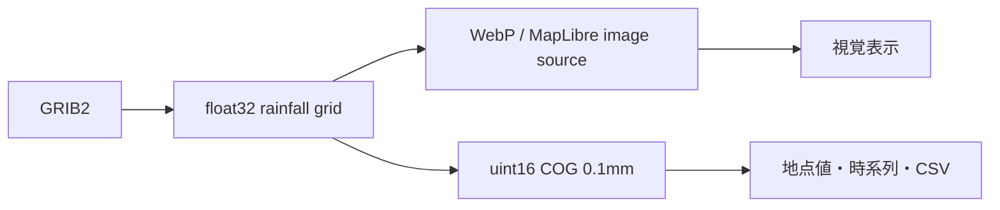

# アーキテクチャ

## 境界

フロントエンド、取得元、デコード、処理、保存先を分離する。特定の気象庁URLやストレージSDKを画面コンポーネントへ持ち込まない。

## 表示と数値の分離

地点値は必ずCOGから取得する。WebPのRGBは表示専用であり、逆変換しない。

## フロントエンドモジュール

- `src/data/`: ProviderとCOG抽出
- `src/map/`: MapLibreライフサイクルとレイヤ
- `src/components/Timeline.tsx`: 日時・再生操作
- `src/components/PointAnalysisPanel.tsx`: 地点分析
- `src/utils/analysis.ts`: 正しい累積雨量
- `src/stores/appStore.ts`: 共有状態と永続設定
- `src/utils/urlState.ts`: URL復元

MapLibreインスタンスはReactの再描画ごとに作り直さない。フレーム切替は同一image sourceのURL更新で行い、地点COGは最大8フレームのLRUキャッシュとする。

## Pythonモジュール

- `sources`: ローカルファイルと公式サンプル取得
- `decoders`: JMA GRIB2独自テンプレート
- `processing`: 色付け、WebP、COG、atomic write
- `metadata`: versioned manifest
- `analysis`: 非重複累積
- `railway`: 測地距離・linear reference
- `indices`: 公式条件を後から差し込む拡張点

